<div align="center">

# IntelliHire

**Screen, interview and assess candidates on evidence, not impressions.**

An AI-powered recruitment and interview intelligence platform. Every conclusion it reaches links
back to a line of the CV or a moment in the interview.

<br>


<br><br>


</div>

---

## Contents

1. [The name](#the-name)
2. [Screenshots](#screenshots)
3. [Features](#features)
4. [Architecture](#architecture)
5. [Technology stack](#technology-stack)
6. [Prerequisites](#prerequisites)
7. [Setup](#setup)
8. [Running, stopping and resetting](#running-stopping-and-resetting)
9. [Usage walkthrough](#usage-walkthrough)
10. [Innovation feature: the candidate feedback composer](#innovation-feature-the-candidate-feedback-composer)
11. [Configuration reference](#configuration-reference)
12. [Measured performance](#measured-performance)
13. [Privacy and data handling](#privacy-and-data-handling)
14. [Known limitations](#known-limitations)
15. [Tests and code quality](#tests-and-code-quality)
16. [Repository layout](#repository-layout)
17. [Further documentation](#further-documentation)

---

## The name

**IntelliHire**: *intelligent* + *hire*.

**Positioning:** IntelliHire screens CVs, runs the live interview and writes the candidate
assessment for hiring teams, and every point it makes links to the CV line or the interview
moment it came from.

**Rationale:** The name says what the product does in two familiar words, so nobody needs it
explained. The "intelligence" is there to help people decide, not to decide for them: the AI
suggests and shows its evidence, and people decide. The name is used the same way in the
repository, this document, the application and the presentation.

---

## Screenshots

All screenshots use synthetic data or show no personal details.

| | |
|---|---|
| 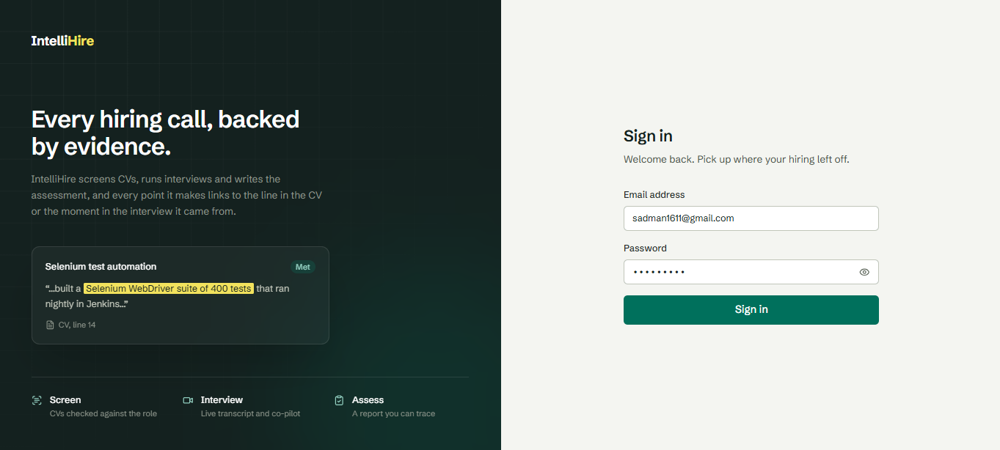 | 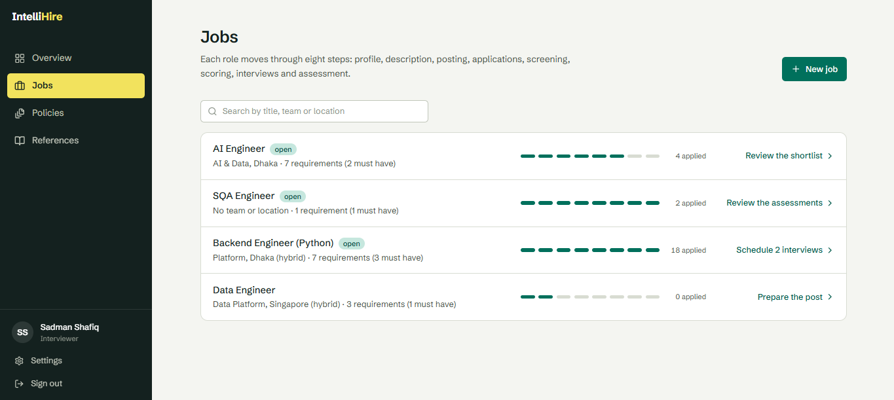 |
| **Sign in.** The product's promise, shown with an evidence card. | **Jobs.** Each role and how far it has moved through the eight steps. |
| 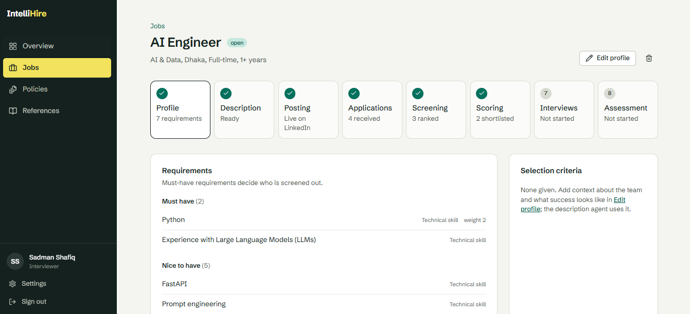 | 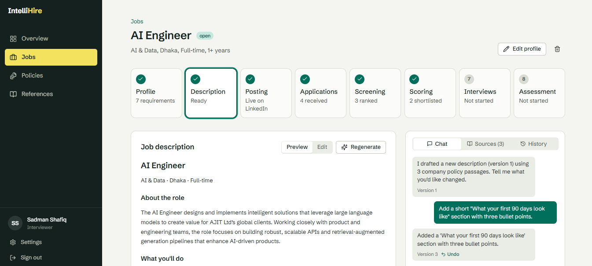 |
| **Job profile.** Requirements, with must-haves marked. | **Job description agent.** A draft built from company policy, with chat, sources and version history. |
| 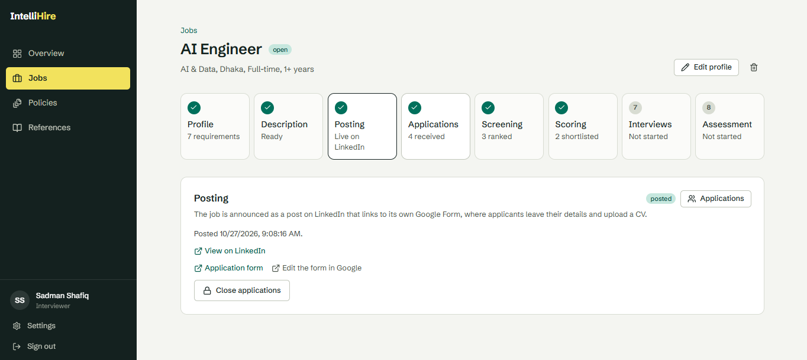 | 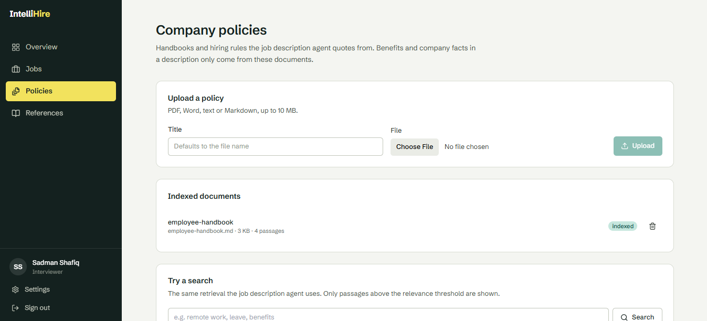 |
| **Posting.** The job goes out as a LinkedIn post that links to its own Google Form. | **Company policies.** Indexed handbooks that the description agent quotes from. |
| 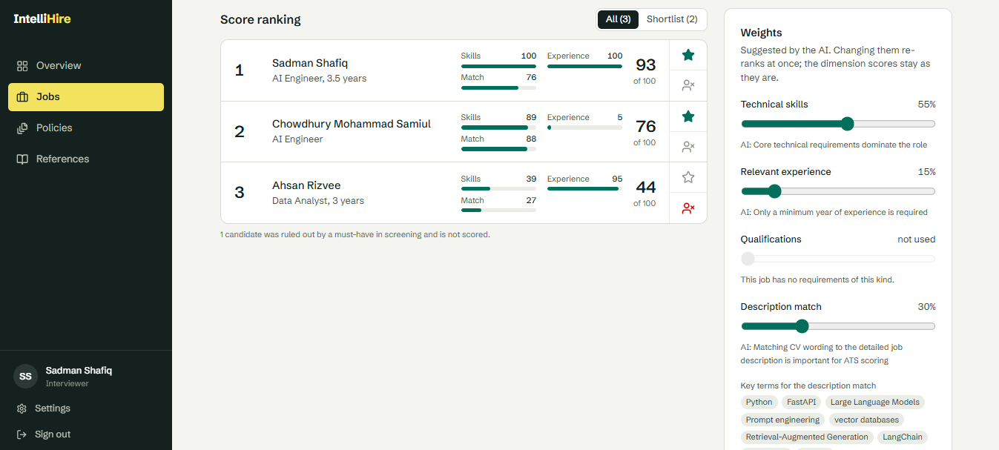 | 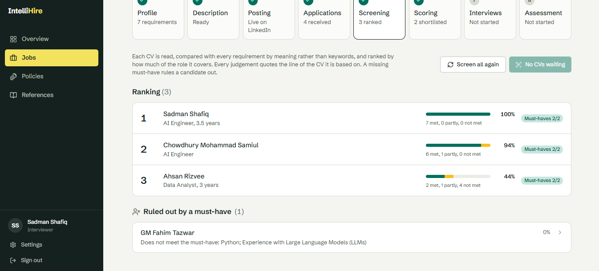 |
| **CV screening** on the 20-CV synthetic batch: ranked, ruled out by a must-have, and could not be screened. | **Candidate scoring.** Evidence-anchored dimensions, AI-proposed editable weights, shortlist and the feedback review queue. |
| 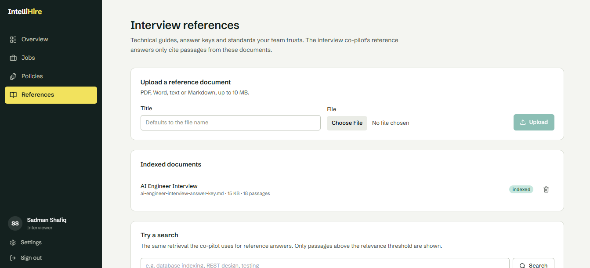 | 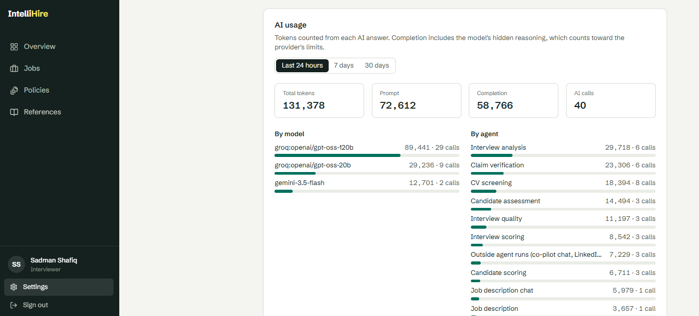 |
| **Interview references.** The material the co-pilot cites, kept apart from the policies. | **System status.** Dependency health, configuration present or missing, and AI token usage per model and agent. |

---

## Features

### Core features

| # | Feature | What IntelliHire does |
|---|---|---|
| F1 | **CV screening and semantic ranking** | Reads PDF and Word CVs, including scans (OCR), two-column layouts and damaged files. Compares each CV with every requirement by meaning rather than keywords. Marks each requirement as met, partly met or not met, with the CV line that shows it, checked word for word. A missing must-have rules the candidate out. The rest are ranked by weighted fulfilment. |
| F2 | **Candidate scoring** | Scores four dimensions: technical skills, relevant experience, qualifications and description match. Each starts from the verified screening evidence. The AI may move a dimension by at most ±15 points, and only with a quote from the CV. The AI proposes the weights; people can edit them and the ranking updates without another AI call. Includes a shortlist and *Select for interview*. |
| F3 | **Interview UI with video** | A WebRTC room hosted in IntelliHire (LiveKit), with a camera and microphone check before joining, rejoin, and attendance recorded from server webhooks. The candidate joins from a secure personal link. There is no Google Meet. |
| F4 | **Live transcription** | Each participant's audio is a separate track, so the speaker of every line is known exactly. Transcribed by Groq Whisper, with local faster-whisper as the fallback. Lines reach the interviewer's panel 0.4–0.75 s after the speaker pauses. |
| F5 | **Q&A analysis and requirement mapping** | Starts automatically when the interview ends. Splits the transcript into questions and answers (small talk is dropped and multi-part questions are split). Scores each answer for relevance, accuracy, completeness and articulation, citing transcript lines. Maps answers to requirements as covered, partly covered or never explored. |
| F6 | **Consolidated assessment** | Combines CV fit (40%), interview answers (40%) and requirement coverage (20%) into a position worked out in code: strong fit, possible fit or not a fit. A must-have with no evidence caps the position. Strengths, weaknesses, evidence gaps and areas to verify each carry their quote. Exports to HTML and PDF. Two to four candidates can be compared side by side. |

### Stretch features (all four attempted)

| # | Feature | What IntelliHire does |
|---|---|---|
| F7 | **Identification and real-time profile** | Optional and based on consent. The candidate's face is matched locally (OpenCV YuNet + SFace) against a template from their own photo. Only encrypted templates are stored, never images. The interviewer can always confirm or reject by hand. The candidate's profile tab stays locked until identity is settled. |
| F8 | **CV claim verification** | Checkable claims are quoted from the CV and compared with what the candidate said: supported, answer differs, not substantiated, or never discussed. Each comes with a follow-up question, and none is worded as an accusation. |
| F9 | **Interview score** | Six dimensions from the interview alone, shown next to the CV-based score, each with its weight, measured base, the AI's capped adjustment and the quotes behind it. |
| F10 | **Interview quality** | Question effectiveness, coverage, speaking balance and consistency with the job's other interviews. Every question is rated, with a better way to ask the weak ones. |

### Innovation feature

| # | Feature | What IntelliHire does |
|---|---|---|
| F11 | **Candidate feedback composer** | Turns the evidence the platform already holds into short, specific and safe feedback letters for candidates, with rule and AI-judge guardrails, a bias screen on notes, and a human approval step before anything is sent. [Full description below.](#innovation-feature-the-candidate-feedback-composer) |

### Supporting features

- **Job description agent:** drafts from the requirement profile and company policy (RAG), with a chat to refine it. Every change is a version you can undo or restore. Biased wording and benefits that policy doesn't support are refused.
- **Job posting and CV collection:** posts to LinkedIn and creates a Google Form per job. Applications and CVs sync automatically every 15 minutes, or on demand.
- **Interview scheduling:** a LangGraph agent reaches Gmail and Google Calendar through IntelliHire's own MCP server. It checks availability, books the event, emails a secure link and an `.ics` file, and supports reschedule and cancel. A failed step undoes the earlier ones. SMTP / MailHog is the fallback.
- **Interviewer co-pilot:** suggested questions aimed at the gaps that matter, with reference answers drawn only from the team's own reference library, plus a streaming chat with checked citations.
- **Candidate data deletion:** one action removes a candidate and everything derived from them.

---

## Architecture

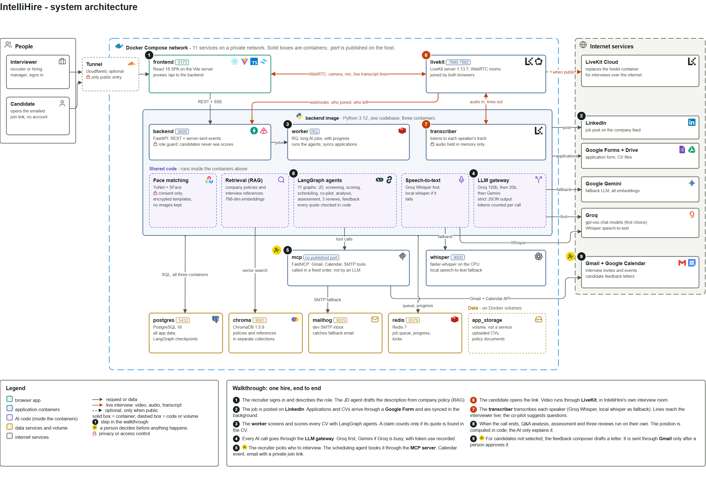

The high-level three-stage view is in [docs/IntelliHire_System_Design_HLD.png](docs/IntelliHire_System_Design_HLD.png).
The build differs from the diagrams in a few places: local JWT replaces Firebase, because a
cloud sign-in would break one-command startup; Groq Whisper with a local faster-whisper fallback
replaces Google Cloud Speech; and email falls back to SMTP when Gmail isn't connected.

### Services

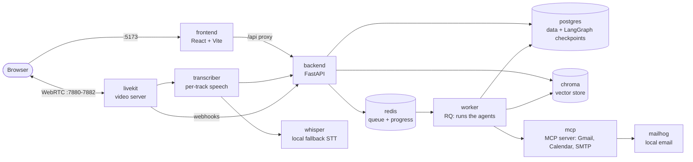

Eleven Docker Compose services: `postgres` `redis` `chroma` `mailhog` `whisper` `mcp` `livekit`
`transcriber` `backend` `worker` `frontend`. A twelfth, `tunnel` (Cloudflare), is off by default
and only gives the app a public address.

### How a request flows

1. An endpoint in `backend/app/api/v1/` checks the user's role and queues a **background job**
   on Redis. The browser gets a job id straight away and polls its progress, so long AI work
   never blocks a request.
2. The **worker** runs the matching LangGraph graph through `agents/runner.run_graph`. That
   writes an audit row with timings and token counts, and the graph's state is checkpointed in
   PostgreSQL.
3. Graph nodes call the LLM through one module (`services/ai.py`): Groq first, Gemini as the
   fallback, with strict JSON-schema output. **Code checks the output before it is saved**:
   every quote must be found word for word in the CV or transcript, and ids that weren't
   provided are removed.
4. Outward actions (email, calendar) go through the MCP server, called by graph nodes in a
   fixed order, never by an LLM choosing tools.

### LangGraph agents

Eleven graphs, each with typed state, several nodes and deterministic check nodes. None of them
is a single LLM call wrapped in a graph.

| Graph | Nodes | Notable for |
|---|---|---|
| Job description | `plan_queries → retrieve_policy → draft → review → finalise` | Review loop sends a draft back for redrafting; chat mode |
| CV screening | `read_cv → extract → match → verify → decide` | Runs in parallel, one CV per thread; quotes verified in code |
| Candidate scoring | `evidence_scores → jd_match → assess → verify → combine` | Evidence first, AI adjustment capped and quoted |
| Interview scheduling | `plan → interpret → find_slot → book → draft → check → send → release` | MCP tools in fixed order; undo on failure |
| Interview co-pilot | `plan → retrieve → suggest → verify → finalise` | Code picks the requirements; citations checked |
| Q&A analysis | `segment → check_segments → use_exchanges → retrieve → evaluate → check_evaluations → map → finalise` | Waits for the transcriber, then runs automatically |
| Consolidated assessment | `compute → write → verify → finalise` | Position computed in code; the AI only explains it |
| CV claims | `extract → check_claims → compare → check_verdicts → finalise` | Wording that accuses is rejected |
| Interview score | `baseline → judge → check → aggregate → finalise` | Measured base plus a capped adjustment |
| Interview quality | `measure → review → check → finalise` | Compares with the job's other interviews |
| Feedback composer | `screen_inputs → select_points → draft_feedback → guardrail_check → human_review → finalize` | Human-in-the-loop `interrupt()`, redraft loop, guardrail fallback |

---

## Technology stack

| | Choice | Version | Why |
|---|---|---|---|
|  | Python, **FastAPI**, Pydantic v2 | 3.12 · 0.143.0 · 2.14.0 | Required by the BID. Pydantic validates every request and generates the OpenAPI document, so the API docs can't drift from the code. |
|  | **LangGraph** with PostgreSQL checkpointing | 1.2.14 | Required by the BID. Checkpointing lets long runs resume, and gives the feedback composer a human-review pause that can last days. |
|   | **Groq** `gpt-oss-120b` / `gpt-oss-20b`, falling back to **Google Gemini** | `google-genai` 2.29.0 | Groq answers in 1–9 s where Gemini took 10–60 s, and allows 1,000 requests a day instead of 20. Both enforce a JSON schema, which matters because every agent returns JSON. Embeddings are always Gemini `gemini-embedding-001`. |
|  | **PostgreSQL**, SQLAlchemy 2, Alembic | 16.15 · 2.1.4 · 1.20.0 | Nearly every question here is a join: candidate → screening → requirement → transcript turn. Migrations apply automatically when the container starts. |
|  | **ChromaDB** | 1.5.9 | Runs as a container with no external account, which keeps clean-machine startup intact. Policies and interview references have separate collections. |
|  | **Redis + RQ** | 7.4.11 · 2.12.0 | Long AI work must not block a request. RQ is much smaller than Celery and is all this project needs. |
|  | **LiveKit** server + `livekit-client` | 1.13.7 · 2.22.3 | A real WebRTC room inside the app. Each participant's audio is a separate track, which is what makes speaker attribution exact. |
|  | **Groq Whisper** `whisper-large-v3-turbo`, local **faster-whisper** fallback | faster-whisper 1.2.1 | Groq transcribes an utterance in well under a second. The local container keeps the transcript going when Groq is rate-limited or not set up. |
|  | Custom **MCP server** (official SDK, FastMCP, Streamable HTTP) | `mcp` 1.30.0 | Email and calendar sit behind one audited, testable boundary. The server holds no credentials; the Google token is passed per request. |
|  | **OpenCV** headless (YuNet + SFace) | 4.14.0 | Face matching runs locally, so no biometric data leaves the machine. |
|   | **React 18 + Vite + TypeScript + Tailwind** | 18.3.1 · 6.0.7 · 5.7.2 · 3.4.17 | The TypeScript types mirror the Pydantic schemas, so a change in response shape breaks the build rather than the demo. React Query handles progress polling. |
|  | Local JWT auth (bcrypt + PyJWT) | | Simple role separation (interviewer, candidate) without a cloud dependency that would break one-command startup. |
|  | **Docker Compose** | | Required by the BID. Every dependency and base image is pinned to an exact version. |

---

## Prerequisites

- **Docker Desktop** (or Docker Engine) with Compose v2.
- A **Google Gemini API key**, free from <https://aistudio.google.com/apikey>. **Required**:
  embeddings come from Gemini, and it is the fallback language model.
- A **Groq API key**, free from <https://console.groq.com/keys>. **Recommended**: it is the
  default language model and transcribes interviews. Without it, Gemini answers everything and
  the local Whisper container transcribes, both more slowly.
- About **4 GB** of free disk space (the Whisper model downloads on first start).

Python and Node are **not** needed on the host; everything runs in containers.

---

## Setup

### 1. Clone and create `.env`

```bash
git clone <repository-url> IntelliHire
cd IntelliHire
cp .env.example .env
```

### 2. Fill in the required values

Edit `.env` and set at least these:

```ini
GOOGLE_API_KEY=your-gemini-key
GROQ_API_KEY=your-groq-key
POSTGRES_PASSWORD=choose-a-password
JWT_SECRET_KEY=a-long-random-value
MCP_SHARED_SECRET=another-long-random-value
LIVEKIT_API_KEY=a-short-random-name
LIVEKIT_API_SECRET=a-random-value-of-at-least-32-characters
```

To generate random secrets without Python on the host:

```bash
docker run --rm python:3.12.15-slim python -c "import secrets; print(secrets.token_urlsafe(48))"
```

`.env` is git-ignored. **Never commit it.**

### 3. Build and start

```bash
docker compose up --build
```

The first build takes several minutes: it installs the OCR and PDF libraries, and the Whisper
model downloads on the speech container's first start. Later starts are fast because both are
cached in named volumes. Database migrations run automatically when the backend starts.

### 4. Open the app

| What | Where |
|---|---|
| Application | <http://localhost:5173> |
| API documentation (OpenAPI / Swagger) | <http://localhost:8000/docs> |
| Liveness probe | <http://localhost:8000/health> |
| Dependency status | <http://localhost:8000/health/ready> |
| Captured outgoing email (MailHog) | <http://localhost:8025> |
| Video server (LiveKit) | `ws://localhost:7880`; media on 7881/tcp and 7882/udp |

Sign up at <http://localhost:5173> and choose the **Interviewer** role (the default).

### 5. Optional integrations

Everything works without these except job posting, form-based CV collection, and scheduling
through Gmail and Google Calendar. Without them, CVs are uploaded by hand and interview emails
go to MailHog at <http://localhost:8025>. The setup costs nothing and takes about 30 minutes.
Put every value in your local `.env` only.

<details>
<summary><b>5a. LinkedIn: post jobs to your feed</b></summary>

<br>

The app posts on **your own** LinkedIn feed. LinkedIn only lets paid Talent Solutions partners
post to its Jobs section, and posting as a company Page needs LinkedIn's approval. A feed post
with the job summary and an application link is open to everyone.

> The post is **public and real**. If you'd rather not post from your main profile, use a
> separate LinkedIn account for the demo.

1. Go to <https://www.linkedin.com/developers/apps> and click **Create app**.
   - **App name:** IntelliHire (or anything you like).
   - **LinkedIn Page:** every app must be linked to a Page. If you don't have one, choose
     **Create a new LinkedIn Page** (a free company Page with any name).
   - Upload any logo and accept the terms.
2. Open the app's **Products** tab and click **Request access** on both of these (each is
   approved instantly):
   - **Share on LinkedIn**
   - **Sign In with LinkedIn using OpenID Connect**
3. On the **Auth** tab, under **Authorized redirect URLs for your app**, add exactly:

   ```
   http://localhost:8000/api/v1/integrations/linkedin/callback
   ```
4. Still on **Auth**, copy the **Client ID** and **Primary Client Secret** into `.env`:

   ```ini
   LINKEDIN_CLIENT_ID=...
   LINKEDIN_CLIENT_SECRET=...
   ```

A LinkedIn connection lasts 60 days; after that, click **Connect** again.

</details>

<details>
<summary><b>5b. Google: create forms and read applications</b></summary>

<br>

This lets the app copy your template form for each job, read the responses, and download the
uploaded CVs from your Google Drive. It uses an **OAuth client**, which is separate from the
Gemini `GOOGLE_API_KEY`.

1. Go to <https://console.cloud.google.com/> and create a project (for example *IntelliHire*),
   or use the one your Gemini key belongs to.
2. Under **APIs & Services → Library**, enable the **Google Forms API** and the **Google Drive API**.
3. Under **APIs & Services → OAuth consent screen** (it may be shown as *Google Auth Platform*):
   - Set the user type to **External**, the app name to *IntelliHire*, and your email as the
     support and developer contact.
   - Under **Audience / Test users**, add the Gmail address you will connect with. Leave the app
     in **Testing**; Google doesn't need to verify it.
4. Under **APIs & Services → Credentials → Create credentials → OAuth client ID**:
   - Choose the application type **Web application**.
   - Under **Authorized redirect URIs**, add exactly:

     ```
     http://localhost:8000/api/v1/integrations/google/callback
     ```
   - Copy the client ID and secret into `.env`:

     ```ini
     GOOGLE_OAUTH_CLIENT_ID=...
     GOOGLE_OAUTH_CLIENT_SECRET=...
     ```

When you connect, Google warns that the app isn't verified. That is expected for an app in
Testing: click **Continue**. While the app stays in Testing, the connection expires after
7 days, so reconnect before a demo.

</details>

<details>
<summary><b>5c. The template application form</b></summary>

<br>

Google's API can't create a file-upload question, so you build one template form by hand. The
app copies it for every job, renames it and adds the job summary.

1. Create a new form at <https://forms.google.com>, signed in with the **same** Google account.
   Title it *IntelliHire application template*.
2. Go to **Settings → Responses → Collect email addresses** and choose **Verified**. Applicants
   have to sign in to upload a file anyway, so this gives a trustworthy email address.
3. Add the questions below. The app recognises them by the words in their titles, so keep the
   wording close:

   | Question title | Type | Required |
   |---|---|---|
   | Full name | Short answer | Yes |
   | Phone number | Short answer | No |
   | Location | Short answer | No |
   | Years of professional experience | Short answer | No |
   | LinkedIn profile URL | Short answer | No |
   | Cover note | Paragraph | No |
   | Upload your CV | **File upload**: allow *PDF* and *Document*, 1 file, up to 10 MB | Yes |
   | I agree that my application and CV are processed to assess me for this job and deleted on request | Checkboxes (one option: "I agree") | Yes |
   | *Optional, for face identification:* Photo | **File upload**: *Image*, 1 file | No |
   | *Optional:* I agree to my photo being used to confirm my identity at interview | Checkboxes (one option) | No |

4. Keep the form in **My Drive**; file uploads don't work in shared drives.
5. Copy the form's ID from its edit URL, `https://docs.google.com/forms/d/`**`THIS_PART`**`/edit`,
   into `.env`:

   ```ini
   GOOGLE_FORM_TEMPLATE_ID=...
   ```
6. After you press **Prepare** for a job, open *Edit the form in Google* once. The copy is made
   through the Drive API, which doesn't create the form's upload folder. Google shows *Missing
   File Upload folders*; press **Restore** to create `Apply: <job> (File responses)` in My
   Drive. Until then the form won't take responses.

</details>

<details>
<summary><b>5d. Gmail and Google Calendar: interview invitations</b></summary>

<br>

With this, the scheduling agent checks your calendar for free time, puts each interview on your
Google Calendar, and sends the candidate one invitation from your Gmail. It uses the same Google
connection, through IntelliHire's own MCP server (the `mcp` container). The interview itself
takes place in IntelliHire, never in Google Meet.

1. In the same Google Cloud project, under **APIs & Services → Library**, enable the
   **Gmail API** and the **Google Calendar API**.
2. Under **Google Auth Platform → Data access → Add or remove scopes**, add these three, then
   click **Save**:

   ```
   https://www.googleapis.com/auth/gmail.send
   https://www.googleapis.com/auth/calendar.events
   https://www.googleapis.com/auth/calendar.freebusy
   ```
3. Optionally, set how invitations are signed:

   ```ini
   EMAIL_SENDER_NAME=Your Name
   EMAIL_SENDER_TITLE=Your Title
   EMAIL_SENDER_COMPANY=Your Company
   ```

The app only asks to *send* mail and to manage *events*. It can't read your inbox, and it sees
only your calendar's busy times, not what the events are.

</details>

**Restart and connect.** After filling in the values:

```bash
docker compose up -d --force-recreate backend worker
```

Then open **Settings → Integrations** in IntelliHire and click **Connect** for LinkedIn and for
Google, ticking every permission on Google's consent screen. Each opens the provider's consent
screen and returns you to the app. A job's **Interviews** step then says invitations are sent
from your Gmail address.

**What applicants see:** the LinkedIn post with an **Apply** link, then the job's Google Form,
which asks them to sign in with a Google account (Google requires this for file uploads). If
they are selected, they get one email with the time in their own time zone, a personal
IntelliHire link and a calendar invitation. A reschedule sends a new link and the old one stops
working.

### 6. Optional: internet access for the candidate link

A remote candidate needs HTTPS and a video server they can reach. With a LiveKit Cloud project
set in `.env` (`LIVEKIT_URL`, `LIVEKIT_PUBLIC_URL`, key and secret) and `ALLOW_REGISTRATION=false`:

```powershell
powershell -File scripts\go-public.ps1           # starts a Cloudflare tunnel and sets PUBLIC_BASE_URL
docker compose up -d --force-recreate transcriber
docker compose stop tunnel                       # takes the app off the internet again
```

Add the webhook address the script prints under LiveKit Cloud → *Settings → Webhooks*. The
tunnel's address changes on every start.

---

## Running, stopping and resetting

Every command needed to build, run, stop and reset the application:

```bash
docker compose up --build            # build images and start everything (foreground)
docker compose up -d                 # start in the background
docker compose ps                    # what is running and whether it is healthy
docker compose logs -f backend       # follow one service's logs
docker compose restart worker        # pick up agent / task code changes (no hot reload)
docker compose restart transcriber   # pick up app/realtime changes
docker compose up -d --force-recreate backend worker   # after editing .env
docker compose stop                  # stop, keep containers and data
docker compose down                  # remove containers, keep data volumes
docker compose down -v               # full reset: ALSO DELETES ALL DATA
```

After `down -v`, the next `docker compose up` recreates every table from the migrations.

**Demo data for the innovation feature** (every person in it is made up):

```bash
docker compose exec backend python -m app.demo.seed_feedback           # add
docker compose exec backend python -m app.demo.seed_feedback --remove  # remove
```

**Delete one candidate and all their data:** use *Delete candidate data* in the screening or
score drawer, or call `DELETE /api/v1/candidates/{id}` (see the OpenAPI docs).

---

## Usage walkthrough

Each job moves through eight steps in its workspace: **Profile → Description → Posting →
Applications → Screening → Scoring → Interviews → Assessment**.

1. **Add company policy.** Go to **Policies** and upload `test_data/policies/employee-handbook.md`
   (an invented handbook). It is indexed in a few seconds; try a search such as "parental leave".
2. **Create a job.** Go to **Jobs → New job**, enter the role and its requirements, and tick
   *Must have* where a requirement is essential.
3. **Generate the description.** Press **Generate with AI** (about 20–40 s, with progress
   shown). Refine it in the chat ("make the summary shorter", "which policy did the benefits
   come from?"). **Sources** lists the policy passages used; **History** lists every version.
4. **Post it** (optional, needs the integrations). The **Posting** step publishes to LinkedIn
   and creates the job's Google Form. Applications sync every 15 minutes, or press **Sync applications**.
5. **Add CVs.** On the **Applications** step, drop PDF or Word CVs. `test_data/cvs/backend-engineer-batch/`
   holds 20 invented CVs, including a scan, a two-column layout, a Spanish CV and a damaged file.
6. **Screen.** On the **Screening** step, press **Screen N CVs**. Open a candidate to see each
   requirement with the CV line highlighted.
7. **Score.** On the **Scoring** step, press **Score N candidates**. Adjust the AI-proposed weights
   with the sliders, star candidates for the shortlist, then **Select for interview**.
8. **Schedule.** On the **Interviews** step, press **Schedule**. Pick a time or describe one
   ("Tuesday afternoon"). The candidate gets an email with their personal link and a calendar file.
9. **Interview.** Press **Start interview**, check your camera, and open the candidate's link
   in another browser or a private window. The live transcript, the **Questions** and
   **Ask the co-pilot** tabs, and the **Profile** tab sit beside the call. Use headphones when
   both browsers are on one machine.
10. **Review.** After **End interview**, the Q&A analysis, the consolidated report and the
    three stretch reviews run by themselves (about 1–2 minutes). Open the analysis from the
    Interviews step. Export the report as a printable page or PDF, and compare candidates on the
    **Assessment** step.
11. **Send feedback.** See below.

---

## Innovation feature: the candidate feedback composer

**This is IntelliHire's Innovation Feature (F11).**

**The gap.** Everything else in IntelliHire helps the company decide. Most candidates then hear
nothing, or get a template, because writing honest, specific and safe feedback for each person
takes time and carries legal risk. The composer turns the evidence the platform already holds
into a short, kind and specific letter, and a person stays in charge of every word that is sent.

**Where it works**

- **After an interview:** for whichever outcome the recruiter chooses (not progressing, on hold,
  next round). It draws on the requirements, the Q&A analysis and the consolidated assessment.
- **At screening:** only for candidates a recruiter explicitly marks *not selected for
  interview*, never inferred from rank. When a CV couldn't be read or screening wasn't
  confident, the candidate gets a polite generic letter written without the AI.

**How it works.** One LangGraph graph, with `stage` in its state:

| Node | What it does |
|---|---|
| `screen_inputs` | Drops interviewer notes that mention or hint at a protected characteristic (age, family, origin, health, accent, "culture fit" and similar proxies). A rule list runs first, then an AI check. Each dropped note is shown with the reason. |
| `select_points` | **Code** picks a few points, each tied to a real requirement and a stored row (a Q&A pair, an assessment finding or a screening result). The model can only word them. |
| `draft_feedback` | Structured output at temperature 0. Code writes the subject, greeting, decision sentence and sign-off. The name and signature are placeholders, filled in only when the letter is sent. |
| `guardrail_check` | Fixed rules (protected characteristics, scores, ranks, other candidates, dates, personal data, promises, offer or salary, contradictions, unsupported sentences, length), then an AI judge whose objections count only if the words it quotes are really in the letter. A failing draft is redrafted up to twice, then the generic letter is used. |
| `human_review` | A LangGraph `interrupt()`. The run waits in the PostgreSQL checkpointer, for days if need be, for **Approve**, **Edit**, **Regenerate** or **Discard**. An edit goes through the guardrails again. |
| `finalize` | Records the result. Sending happens only on **Send**, once, through MCP email (Gmail or SMTP), or to a local `.eml` outbox if no email channel can be reached. |

**What it never does:** write offer, salary or onboarding content, state a score or rank,
compare with other candidates, or choose the outcome.

**Try it:** run `docker compose exec backend python -m app.demo.seed_feedback`, open the
assessment it prints and choose the **Candidate feedback** tab. The demo includes a biased
interviewer note on purpose, so you can watch it being struck out.

---

## Configuration reference

Every value comes from an environment variable; none is hard-coded. The full list is in
[.env.example](.env.example). The ones that matter most:

| Variable | Purpose | Default |
|---|---|---|
| `GOOGLE_API_KEY` | Gemini: embeddings and the fallback language model. **Required.** | *(empty)* |
| `GROQ_API_KEY` | Groq: the default language model and live transcription. | *(empty)* |
| `LLM_PROVIDERS` | Language model services, in order. | `groq,gemini` |
| `GROQ_LLM_MODELS` | Groq models, in order. | `openai/gpt-oss-120b,openai/gpt-oss-20b` |
| `GEMINI_MODEL` / `GEMINI_FALLBACK_MODELS` | Gemini models, in order. | `gemini-3.5-flash`, … |
| `GEMINI_EMBEDDING_MODEL` | Embedding model (768 dimensions). | `gemini-embedding-001` |
| `LLM_TEMPERATURE` | Fixed at 0 so scoring is reproducible. | `0.0` |
| `POSTGRES_PASSWORD` | Database password. **Required.** | *(empty)* |
| `JWT_SECRET_KEY` | Signs access tokens. **Required.** | *(empty)* |
| `ACCESS_TOKEN_EXPIRE_MINUTES` | Session length. | `720` |
| `ALLOW_REGISTRATION` | Whether people can sign up. Turn off on a public address. | `true` |
| `MCP_SHARED_SECRET` | Shared between the backend and the MCP server. **Required.** | *(empty)* |
| `LIVEKIT_API_KEY` / `LIVEKIT_API_SECRET` | Sign room tokens and webhooks. **Required.** | *(empty)* |
| `LIVEKIT_URL` / `LIVEKIT_PUBLIC_URL` | The video server as the backend and the browsers reach it. | the local `livekit` container |
| `LIVEKIT_NODE_IP` | Address browsers send media to. | `127.0.0.1` |
| `PUBLIC_BASE_URL` | Base for candidate links. | `http://localhost:5173` |
| `SMTP_HOST` / `SMTP_PORT` | Email fallback when Gmail isn't connected. | `mailhog` / `1025` |
| `MAX_UPLOAD_MB` | Upload size limit, checked before parsing. | `10` |
| `POLICY_MIN_SCORE` | Minimum cosine relevance for a policy passage. | `0.55` |
| `SCREENING_CONCURRENCY` | CVs screened at once. | `3` |
| `AUTO_SYNC_MINUTES` | Application sync interval (0 = off). | `15` |
| `SPEECH_SILENCE_MS` | Pause that ends an utterance. | `700` |
| `WHISPER_MODEL_SIZE` | Local fallback model. | `base.en` |
| `COPILOT_DISCUSSED_SIMILARITY` | When the co-pilot treats a requirement as already discussed. | `0.78` |
| `FEEDBACK_MIN_CONFIDENCE` / `FEEDBACK_MIN_CV_CHARS` | Below these, screening feedback is the generic letter. | `0.5` / `300` |
| `FACE_REFERENCE_KEEP_DAYS` / `FACE_PHOTO_MAX_DAYS` | Biometric retention. | `7` / `30` |

---

## Measured performance

Measured on the running stack with free-tier API keys:

| What | Result |
|---|---|
| **20-CV batch screening** (synthetic batch, 3 CVs at a time) | About **10 s per CV**. The first pass took 69.5 s before the free-tier quota ran out; the remaining 8 CVs took a further 23.6 s. Result: 12 ranked, 6 ruled out by a must-have, 2 set aside (Spanish, damaged), 0 failed. Without quota limits, the estimate is 1–1.5 minutes for the batch; that was not measured in one run. |
| **Scoring** (12 ranked candidates) | 21–31 s per run. A rescore gave identical scores for everyone. |
| **Live transcription latency** | **0.4–0.75 s** from the end of an utterance to the interviewer's panel with Groq; 2–5 s with the local Whisper fallback on CPU. |
| **After an interview** | Analysis plus assessment in about 1–2 minutes; the three reviews add up to a minute. |
| **AI token usage** | Shown under **Settings → System status** and at `GET /api/v1/usage`. The full end-to-end run on 27 Oct used 58 LLM calls and 175k tokens. |

---

## Privacy and data handling

- **No real CVs in the repository.** Development uses synthetic data (`test_data/`, committed)
  or locally held CVs in `sample_data/` (git-ignored).
- **Logs** are structured and redacted: sensitive keys are blanked and email addresses masked.
  Names, CV text and prompts are never logged.
- **Raw audio is never written to disk.** An utterance stays in memory until it is transcribed.
  The call is not recorded; only the transcript is stored.

### Which external services receive candidate data

| Service | When | What it receives |
|---|---|---|
| **Groq** | `GROQ_API_KEY` set (default LLM) | CV text with name, email and phone removed; job requirements; transcript text. For the co-pilot, also the interviewer's chat messages. Interview audio, one short utterance at a time, for transcription. |
| **Google Gemini** | Fallback LLM; all embeddings | The same text when Groq is busy or not set up. Embeddings of policies, references, job descriptions, CV text and transcript lines. |
| **Google Forms / Drive** | Job posting is used | Applicants' details and CVs, entered by the applicants themselves. Deleting a candidate in IntelliHire does **not** delete these copies; remove them in Google as well. |
| **Gmail / Google Calendar** | Google connected | The candidate's name, email, interview time and job title. The AI that drafts the email never sees the name or address. |
| **LinkedIn** | Job posting is used | Only the public job post text. No applicant data. |
| **LiveKit Cloud / Cloudflare** | Only when made public | Call media and web traffic in transit. Nothing is recorded. |
| **Local only** | Always | MailHog, faster-whisper and the face model run in containers, so their data stays on the machine. |

The feedback composer's LLM calls receive the job title, requirement texts, the evidence behind
each chosen point and the notes that passed the bias screen. They never receive the candidate's
name, contact details, scores or CV.

### Biometric data (face identification)

- **Optional and consent-first.** A face is only used if the candidate agrees, either with a
  separate checkbox on the application form or on their interview page, where the full wording
  is shown before the camera opens. Saying no changes nothing about how they are assessed. Every
  yes, no and withdrawal is recorded with the wording version.
- **A template, never a picture.** A photo becomes a face template (128 numbers, computed
  locally) and is then deleted. Templates are encrypted in the database. Live frames are only
  held in memory.
- **Retention.** Templates are deleted 7 days after the interview; unused form photos are deleted
  from Drive after 30 days. A worker sweeps every hour. Withdrawing consent deletes the template
  at once.
- **Never a scoring input.** Face data never reaches screening, scoring, analysis or the
  assessment, and the match never settles identity on its own.

### Deleting a candidate

**Delete candidate data** (or `DELETE /api/v1/candidates/{id}`) removes the candidate and
everything derived from them, for every job: CV files and text, applications, screenings,
scores, interviews and transcripts, co-pilot suggestions, assessments, reviews, feedback letters,
biometric records, and the LangGraph checkpoints that hold CV text. If the checkpoints can't be
removed, nothing is removed. Audit rows holding only ids and timings are kept.

### Fairness

Scoring uses job-relevant criteria only. Identity fields live in a separate table and never reach
a scoring prompt; name, email and phone are removed from the CV text before comparison. Age,
gender, ethnicity, nationality, religion and marital status are never inputs. Generated
questions, reviews and feedback are checked for protected characteristics and gendered words.

**Limitation:** indirect signals such as a university name or a graduation year remain in the CV
text, and the bias checks are rule lists plus an AI judge, not guarantees. A person reviews every
description and approves every feedback letter.

---

## Known limitations

1. **Free-tier limits.** Groq allows 8,000 tokens a minute per model and Gemini about 20 requests
   a day per model. A 20-CV batch runs partly on the fallbacks; CVs left over are screened on the
   next **Screen** press. When every model is busy, the request fails with a clear message.
2. **The local interview room** works for browsers on the Docker machine, or on a LAN with
   `LIVEKIT_NODE_IP` set. Internet use needs the LiveKit Cloud and tunnel setup. Locally,
   signalling is plain `ws://` (media is still DTLS-SRTP encrypted).
3. **Speakers are identified by track, not by voice.** Without headphones, echo cancellation
   usually, but not always, stops the other person's voice being transcribed twice.
4. **Scores are reproducible, not provably deterministic.** Temperature 0 and capped adjustments
   get most of the way (a rescore of 12 was identical), but a fallback model may judge differently.
   Each score records its model. Interview analysis scores can vary between runs.
5. **Assessment weights are fixed** at 40 / 40 / 20, with strong fit from 70, for every job.
6. **English CVs only.** Other languages are set aside with a reason, for a person to read.
7. **LinkedIn posts go to the member's feed, not LinkedIn Jobs** (that API is partner-only). The
   connection lasts 60 days.
8. **Applicants need a Google account** to upload a file to a Google Form, and the CV and photo
   questions must be added to the template by hand. Applications arrive within 15 minutes; there
   is no webhook.
9. **The Google OAuth app is in Testing mode,** so its refresh token expires after 7 days and
   Google must be reconnected before a demo.
10. **Face matching is not tuned on real interviews.** Poor light often gives "uncertain", and the
    interviewer confirms by hand. Voice identification is not built.
11. **Scanned policy PDFs are not OCR'd** (CVs are). Upload a text version instead.
12. **The co-pilot is not instant.** Suggestions take 15–40 s. Its "already discussed" threshold
    was calibrated on one synthetic interview.
13. **Feedback outbox.** A letter saved to the outbox folder has to be forwarded by hand.
14. **Clean-machine start** (`down -v` then `up`) was last repeated before the final base-image pins.

---

## Tests and code quality

```bash
docker compose exec backend pytest                 # 433 backend tests
docker compose exec mcp pytest                     # 10 MCP server tests
docker compose exec backend ruff check .           # lint
docker compose exec backend ruff format --check .  # formatting
docker compose exec backend alembic current        # applied migration
docker compose exec frontend npm run typecheck     # TypeScript
docker compose exec frontend npm run lint          # ESLint
```

Tests run with fake AI providers, an in-memory vector store and inline background jobs, so they
need no API keys and never reach Groq or Gemini.

---

## Repository layout

```
backend/            FastAPI app, LangGraph agents, worker, transcriber
  app/api/v1/       HTTP endpoints only
  app/agents/       one package per LangGraph graph, plus state, checkpointer and runner
  app/services/     business logic (screening, scoring, interviews, assessment, feedback, ...)
  app/tools/        every third-party call: LLM, MCP client, LiveKit, face model, HTTP
  app/realtime/     the transcriber: joins rooms, cuts utterances, Groq / Whisper
  app/models/       SQLAlchemy ORM; alembic/ holds the migrations
  tests/            pytest suite
mcp_server/         IntelliHire's MCP server (Gmail, Google Calendar, SMTP tools)
whisper_service/    local speech-to-text container
frontend/           React + Vite + TypeScript + Tailwind
docs/               BID, WBS, architecture diagrams, screenshots
test_data/          synthetic CVs, policies and references (committed)
sample_data/        real CVs, if any (git-ignored)
scripts/            go-public.ps1
```

---

## Further documentation

| Document | Contents |
|---|---|
| [docs/](docs/) | BID, WBS, architecture and system design diagrams, screenshots |
| [http://localhost:8000/docs](http://localhost:8000/docs) | The API reference (OpenAPI), once the stack is running |

    
    